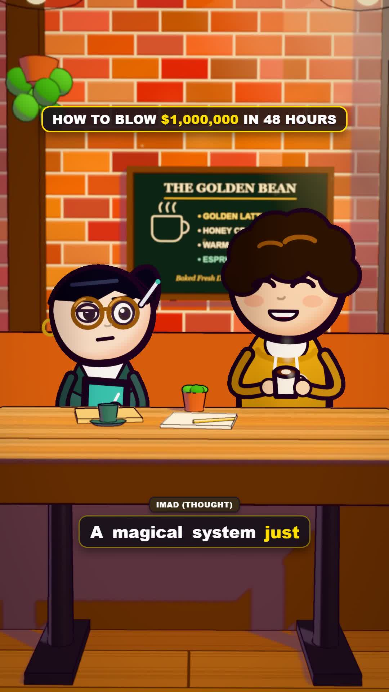
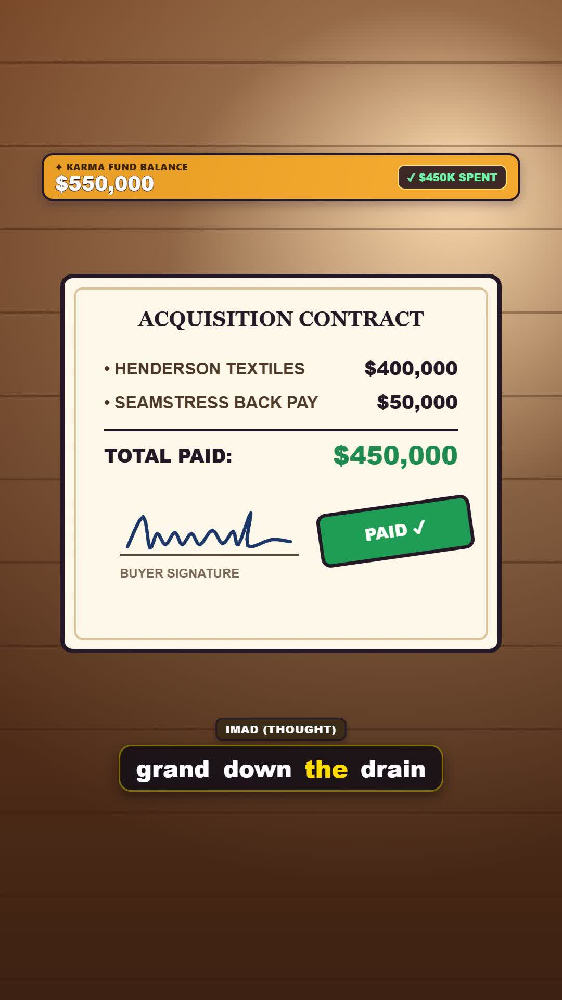
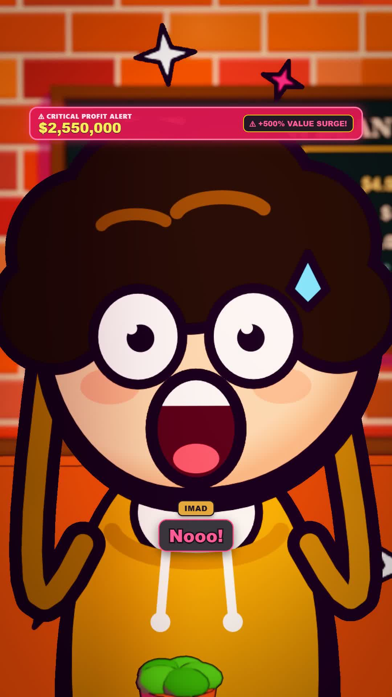

# AnimatorSkillMcp

**The Complete Animation Creation MCP Server, Agent Skill, 9-Stop Physics Engine & Kounkan+ Hybrid 2D-in-3D Studio.**

AnimatorSkillMcp unifies an agentic **Model Context Protocol (MCP)** server (`mcp_server/server.py`), global AI coding agent **Skills & Slash Commands**, a zero-cost **multi-voice WordBoundary TTS & `-14.4 LUFS` stereo mastering** DSP pipeline, and a **Remotion + Three.js (`@remotion/three` + `@react-three/postprocessing`)** rendering engine that produces viral `1080x1920` (9:16) story shorts locally with **zero AI character drift**.

---

## Showcase Previews (*Burn It to Earn It* — Episode 1, 70s Kounkan+ Hybrid)

| Hook & Cozy 3D Café (`Shot 1`) | 2D Signature & Contract Insert (`Shot 22`) | Alert Grade & Panic Cliffhanger (`Shot 27`) |
| :---: | :---: | :---: |
|  |  |  |

---

## Key Capabilities

### 1. MCP Server (`mcp_server/server.py`)
Run via standard MCP stdio (`python mcp_server/server.py`) across **Antigravity**, **Claude Code**, or **Cursor**:

| MCP Tool | Purpose |
| :--- | :--- |
| `preflight_studio` | Verifies Python packages (`mcp`, `edge_tts`, `numpy`, `scipy`, `PIL`), `ffmpeg`/`ffprobe`, Node/Remotion, WebGL Chrome/Edge, `assets/sfx/`, and optional `.env` keys. |
| `list_styles_and_stops` | Returns the full **9-style catalog** (`kounkan_plus` + 8 presets), existing compositions, and the **9 Gated Production Stops**. |
| `create_episode_project` | Scaffolds `SCRIPT.md`, `character_bible.json`, rhythmic `2.5s`-beat `shots.json`, and `voice/segments_config.json`. |
| `generate_voice_with_alignment` | Synthesizes zero-cost multi-voice Edge-TTS stems with sequential non-overlapping placement, `lip_sync=False` narrator/thought separation, visemes, and `WordBoundary` `words.json`/`segments.json`. |
| `master_audio_mix` | Generates speech-ducked `48 kHz` stereo Rhodes music + 4x-oversampled look-ahead limiting (`<= -1.2 dBTP`) normalized cleanly to **`-14.4 LUFS`** via EBU R128. |
| `render_short_video` | Runs rapid `remotion still` QA frames or full `1080x1920` 30 fps ANGLE WebGL renders + AAC `48 kHz` stereo muxing. |
| `audit_short_quality` | Executes physics & cadence unit tests, speech overlap checks, `ffprobe` stream inspection, `ebur128` loudness audits, and scene-cut counts. |

Includes MCP Resources (`animator://skill`, `animator://style-bible`, `animator://stops`) and MCP Prompt (`create_kounkan_plus_short`).

### 2. Visual Styles Supported
* **`kounkan_plus`** *(Flagship Hybrid 2D-in-3D)* — Cel-shaded 3D worlds (`InkPass` + thin-lens `LensBlur` + warm/alert `GradeEffect`), multi-angle expressive 2D character rigs, `2.0–3.5s` rhythmic cuts, custom 2D close-up mechanical/UI insert panels (`Inserts.tsx`), and `<AbsoluteFill>` safe-zone word-highlighted subtitles (`Overlays.tsx`).
* **8 Specialized Presets** (`templates/styles/style_registry.ts`): `storybook`, `comic_noir`, `papercraft`, `rubber_hose`, `kurzgesagt`, `anime_sakuga`, `retro_90s`, `sumi_ink`.

### 3. The 9 Gated Production Stops
Enforced across scripts, rigs, shaders, physics, audio, and QA (`SKILL.md`):
1. **Script & Physics Blueprint** — Immediate paradox hook, rhythmic `2.0–3.5s` beats (`3.1–3.8 w/s`).
2. **Acoustic & Viseme Alignment** — `0` overlaps, spoken dialogue vs. `lip_sync=False` inner monologue separation.
3. **Camera Frustum & Safe Zones** — Symmetric smootherstep glides (`<= 25 px/f`), HUD above `15%` top, captions clear of `20%` bottom.
4. **Collision & Newtonian Physics** — Exact table/ground planes, cantilever edge-pivoting kinematics, `g = 9.81 m/s²` drag ballistics.
5. **Articulated Rig & Context-Motivated Motion** — 2-bone analytical IK, zero foot skating (`< 0.0001 m/s`), stationary feet in `stand` mode.
6. **Zero-GC 3D Engine** — Static `MathPool` registers, `InstancedBatch`, smart texture caching.
7. **Post-Processing** — `InkPass` (with `NOINK` actor layer) → `LensBlur` DoF → `Bloom` → `NEUTRAL` ToneMapping → `GradeEffect`.
8. **Stereo Audio DSP** — Real WAV foley (`assets/sfx/`, 43 sounds) + ducked BGM mastered to `-14` to `-15 LUFS` stereo.
9. **Automated QA Gate** — `audit_physics.py`, `audit_cadence.py`, `short_qa.py`, `ffprobe`, and `ebur128` verification.

---

## Repository Structure

```text
AnimatorSkillMcp/
├── mcp_server/
│   ├── server.py               # FastMCP stdio server (7 tools, 3 resources, 1 prompt)
│   └── studio_ops.py           # Portable core pipeline operations
├── studio/
│   ├── cartoon_engine/         # Remotion 4 + Three.js engine & compositions
│   │   ├── src/videos/imad/    # 70s Kounkan+ Hybrid Episode 1 ("Burn It to Earn It")
│   │   ├── src/videos/toast/   # Multi-style 10s showcase (Comic Noir, Rubber Hose, Kurzgesagt)
│   │   ├── src/videos/vienna/  # Broughton suspension bridge benchmark
│   │   ├── src/videos/stoneage/# Stone Age Hoodie world
│   │   └── render_*.py         # Portable ANGLE WebGL render & AAC mux pipelines
│   ├── episodes/
│   │   ├── imad_episode1/      # Script, locked character bible, voice & -14.4 LUFS mix scripts
│   │   └── toast_physics/      # Multi-style script, shots, & kinematic audit
│   └── ai_workflows/           # Optional Pollinations / Fal / Higgsfield scripts
├── templates/                  # Shared Rigs, Physics, Engine, Shaders, Audio DSP, QA Scripts
├── references/                 # Style Bible & 20 reference contact sheets
├── assets/sfx/                 # 43 curated WAV foley sound effects
├── commands/                   # /cartoon-short, /animated-short, /cartoon-3d-short
├── scripts/install.py          # Setup helper for skills, deps, & MCP config
├── tests/test_mcp_server.py    # Automated MCP stdio & QA verification suite
├── SKILL.md                    # Complete agent skill prompt specification
├── plugin.json                 # Plugin bundle manifest
└── .mcp.json                   # MCP server entrypoint manifest
```

---

## Quick Start

### 1. Prerequisites
- Python **3.10+**
- Node.js **18+** & npm
- `ffmpeg` and `ffprobe` on `PATH`
- Google Chrome / Chromium / Edge (for Remotion headless ANGLE WebGL rendering)

### 2. Install & Link Globally
```bash
git clone https://github.com/Marodioss/AnimatorSkillMcp.git
cd AnimatorSkillMcp

python scripts/install.py --install-python --install-node --link-skills
```

### 3. Connect the MCP Server
Use the generated JSON snippet from `scripts/install.py` (or `mcp_config.example.json`) inside your Antigravity `~/.gemini/config/mcp_config.json`, Claude Desktop config, or workspace `.mcp.json`:

```json
{
  "mcpServers": {
    "animator-skill": {
      "command": "python",
      "args": ["/ABS/PATH/TO/AnimatorSkillMcp/mcp_server/server.py"]
    }
  }
}
```

### 4. Re-Render the Flagship 70s Episode (`Burn It to Earn It`)
```bash
python studio/episodes/imad_episode1/voice/generate_voice.py
python studio/episodes/imad_episode1/audio/generate_audio_mix.py
python studio/cartoon_engine/render_imad_ep1.py
```

### 5. Run Full Automated Verification
```bash
python -m unittest discover -s tests -v
```

---

## License
MIT (see [LICENSE](LICENSE)). Reference frames under `references/` are included for style study and measurement. Derived from [`mromidev/claude-animated-shorts`](https://github.com/mromidev/claude-animated-shorts) and massively expanded with multi-style rigs, collision/IK physics, Kounkan+ 2D-in-3D compositing, broadcast stereo audio mastering, and a full FastMCP creation server.
