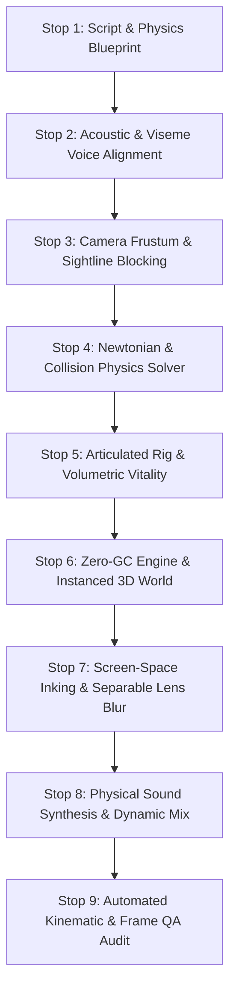

# Cartoon 3D Story Short Engine (Multi-Style & Physics-Accurate)

Proven benchmarks: 
- **The Bridge That Fell for a Song** (67 s vertical short about the 1831 Broughton suspension bridge collapse).
- **The Buttered Toast Law** (10 s multi-style short across Comic Noir, 1930s Rubber Hose, and Kurzgesagt styles).

Composition standard: 1080x1920 (preview/stills) to 1440x2560 (final 2K master), 30 fps.
Zero-Slacking Policy: Strict compliance with all 9 Production Stops. No simplified curve shortcuts, no foot skating, zero object clipping, exact surface collisions, and zero per-frame heap allocations.



---

## Slash Commands & Quick Invocation

Trigger the skill anytime using slash commands or conversational triggers:
- `/cartoon-short <story idea>`
- `/animated-short <story idea>`
- `/cartoon-3d-short <story idea>`
- *"Make an animated short about [topic] in [style] style"*

---

## 8 Pluggable Visual Styles

Select any style in your composition with a single configuration flag (`getStyle(styleId)`):

```typescript
import { getStyle } from "templates/styles/style_registry";
const currentStyle = getStyle("comic_noir"); // or "papercraft", "rubber_hose", "kurzgesagt", etc.
```

### Style Catalog & Feature Matrix

| Style Key | Display Name | Character Rig | Frame Cadence | Signature Post Shaders | Audio Profile |
|---|---|---|---|---|---|
| `storybook` | **Painted Storybook** | 2D Bean-head (`rig.ts`) | 30 fps smooth | Thin-lens DoF + Bloom | Orchestral March (120 bpm) |
| `comic_noir` | **Living Comic / Spider-Verse** | High-contrast (`ComicRig.ts`) | 15 fps (on twos) | Halftone Dots + CMYK Offset | Boom-bap & 808 Sub Drops (92 bpm) |
| `papercraft` | **Stop-Motion Papercraft** | Hinged cutouts (`PaperRig.ts`) | 12 fps (twos/threes) | Layer Drop Shadows + Card Grain| Foley: Scissor & Cardboard (104 bpm) |
| `rubber_hose` | **1930s Vintage (Cuphead)** | Noodle limbs (`HoseRig.ts`) | 30 fps (2-beat bob) | Film Gate Weave & Scratches | Ragtime Stride Piano & Whistle (132 bpm) |
| `kurzgesagt` | **Flat Vector Infographic** | Geometric pills (`VectorRig.ts`)| 30/60 fps snappy | Vector Gradient Ramp + Bloom | Ambient Synth & UI Clicks (110 bpm) |
| `anime_sakuga`| **2.5D Cel-Shaded Anime** | Articulated (`rig.ts`) | Variable (bursts) | 3-Tone Cel Ramp + Speedlines | Cinematic Taiko & Metal Rings (140 bpm) |
| `retro_90s` | **Retro 90s Low-Poly** | Low-poly faceted | 20–30 fps | Affine UV Warp + Bayer Dither | 16-Bit Chiptune Synth (124 bpm) |
| `sumi_ink` | **Traditional Sumi-e Wash**| Calligraphic brush strokes | Fluid continuous | Xuan Rice Paper Bleed | Shakuhachi Flute & Singing Bowl (68 bpm)|

---

## The 9 Gated Production Stops ("Respect All Stops")

### Stop 1: Script & Physics Blueprint
- **Cadence**: 3.5 to 3.8 words/second, 55–70 seconds total (or tight 10–15 s micro-shorts).
- **Beat Structure**:
  1. *Hook*: Paradox stated as plain fact in line 1 (~10–14 words, no preamble).
  2. *Setting*: Time, place, named figures, concrete stakes.
  3. *Escalation*: 3–4 escalating beats, building rhythm and physical tension.
  4. *The Break/Snap*: The catastrophic turning point.
  5. *Deadpan Double*: "Luckily ... / Unluckily ...".
  6. *Physics Mechanism*: The physical principle explained with an everyday analogy.
  7. *Payoff & Callback*: Ironic final twist; cut precisely on the last syllable.
- **Gate Requirement**: Output `SCRIPT.md` with explicit beat timestamps and physical causality notes before proceeding.

### Stop 2: Acoustic & Viseme Voice Alignment
- **Audio Prep**: Generate or record voice narration (`voice.wav`), generate `words.json` containing exact word start/end timestamps.
- **Viseme Mapping**: Use `templates/character/visemes.ts` to map syllables to anatomical mouth shapes (`rest`, `mbp`, `fv`, `ai`, `e`, `o`, `u`, `wq`).
- **Gate Requirement**: Every spoken word must have corresponding viseme keyframes landing 0–2 frames before acoustic onset.

### Stop 3: Camera Frustum & Sight-Line Blocking
- **Camera Grammar**:
  - Moves are symmetric **smootherstep glides** ($6x^5 - 15x^4 + 10x^3$) over 18–40 frames.
  - Peak translation speed strictly clamped: $\le 25\text{ px/frame}$ at 720p equivalent.
  - No static holds: every hold pushes in continuously at $0.15\text{--}0.35\%/\text{frame}$ ($0.6\%/\text{frame}$ on punch words).
  - Cinematic rolls of $4^\circ\text{--}5^\circ$ on impact/fall beats.
  - Impact kicks: sign-flipping alternating shakes decaying over 7 frames.
- **Sight-Line Culling**: Raycast from camera positions along sight vectors (`sightLines()`) to cull any buildings or foliage blocking the frame.

### Stop 4: Exact Collision & Newtonian Physics Solver
- **Exact Surface Collision & Sliding**:
  - Objects moving across tables, counters, or ground must never penetrate the surface geometry ($y_{\text{obj}} \ge y_{\text{surface}} + \text{halfThickness}$).
- **Cantilever Edge-Pivoting Kinematics**:
  - When sliding off a table edge, the bottom contact point anchors to the table lip $(x_{\text{lip}}, y_{\text{lip}})$ with **zero contact drift** ($< 10^{-6}\text{ m}$):
    $$x(t) = x_{\text{lip}} - s \cos(\theta) + b \sin(\theta)$$
    $$y(t) = y_{\text{lip}} + s \sin(\theta) + b \cos(\theta)$$
  - Rotates smoothly under gravitational torque ($\theta = 0 \to \theta_{\text{release}}$) before entering free fall.
- **Ballistic Trajectories** (`templates/physics/ballistics.ts`):
  $$\mathbf{a}(t) = \mathbf{g} - \frac{1}{2m} \rho C_d A \|\mathbf{v}\|\mathbf{v}$$
  Enforces true parabolic arcs with aerodynamic drag ($g = 9.80665\text{ m/s}^2$).
- **Zero Object Clipping**:
  - Maintain strict clearance planes between character billboards, furniture tops, props, and screen-space FX text billboards.

### Stop 5: Articulated Rig, Volumetric Vitality & Context-Motivated Movement
- **Context-Motivated Movement (Zero Idle Fidgeting / No Treadmill Legs)**:
  - Characters MUST ONLY move when motivated by narrative context, story beats, or physical locomotion across space.
  - When standing at a counter, desk, ladder, or mark ($v_{\text{world}} = 0$), characters MUST be set to `mode: "stand"`.
  - In `stand` mode, feet are strictly planted on the floor with **ZERO leg cycling, ZERO knee pumping, and ZERO foot paddling**.
  - Locomotion walk/march cycles are strictly prohibited unless the character's root position is actively translating across world coordinates ($v_{\text{world}} > 0$).
  - Upper body movement is motivated by story causality: intentional arm reaches, accidental bumps, head turns, downward gaze tracking, and facial expression swaps on story beats.
- **Volumetric Character Vitality**:
  - Subtle sinusoidal **breathing cycles** and dynamic pelvic **weight shifting** give characters physical volume without nervous twitching.
  - Intentional **physical impulse interactions** (elbow bumps, reaching, pushing) establishing clear causality for object movements.
  - **Downward Gaze Tracking**: Correct canvas coordinate orientation ($+Y$ down), ensuring character pupils actively track action and falling props.
- **Analytical 2-Bone IK** (`templates/physics/ik.ts`):
  - Solves elbow/knee joint positions using Law of Cosines with anatomical angle limits.
- **Zero Foot Skating** (`templates/physics/contacts.ts`):
  - Stance phase planted foot world velocity is strictly zero ($v_{\text{slip}} < 0.0001\text{ m/s}$).
  - Inverted pendulum center-of-mass motion.
- **Volume-Preserving Squash & Stretch** (`templates/character/squash.ts`):
  $$S_x \cdot S_y = 1.0 \implies S_x = \frac{1}{\sqrt{S_y}}$$
  Ground soles remain pinned during impact squash.
- **Secondary Dynamics** (`templates/character/secondary.ts`):
  - 2nd-order damped springs ($\ddot{x} + 2\zeta\omega_n \dot{x} + \omega_n^2 x = 0$) drive hats, feathers, plumes, scabbards, and belts.

### Stop 6: Clean High-Performance 3D World Engine
- **Zero Heap Allocations in Render Loop**:
  - Never allocate `new THREE.Vector3()`, `Matrix4()`, or closures in `update()` or per-frame functions.
  - Use pre-allocated registers from `templates/engine/math_pool.ts` (`MathPool.V0` through `V15`, `M0` through `M7`).
- **InstancedMesh Batching** (`templates/engine/instancing.ts`):
  - Consolidate repeated trees, bushes, flowers, fences, bridge stays, and lanterns into `InstancedBatch`.
  - Draw call budget: $\le 45$ calls per full render pass.
- **Smart Texture Cache** (`templates/engine/atlas.ts`):
  - LRU caching with dirty-rect invalidation to stop GPU texture bus saturation.

### Stop 7: Post-Processing & Screen-Space Edge Inking
- **Pass Order**:
  $$\text{World Normal/Depth} \longrightarrow \text{FastInkPass} \longrightarrow \text{FastLensBlurPass} \longrightarrow \text{Bloom} \longrightarrow \text{NEUTRAL ToneMap} \longrightarrow \text{ColorGrade}$$
- **Ink Parameters** (`templates/shaders/ink_fast.ts`):
  - World lines: $3.3\text{--}5.1\text{ px}$ at 1080p, near-black `#030303`.
  - Character plum ink: `#241726`.
  - Characters, clouds, and skies live on layer `NOINK` (Layer 3) to prevent bounding box outlines.
- **Lens Blur**: Thin-lens DoF with Circle-of-Confusion radius $c_{\infty} = 10\text{--}16\text{ px}$ at 1080p, focused on the front character's eyes.
- **Color Grade**: Day median luma $\sim 0.57$, non-ink p5 $\sim 0.23$. Golden hour: peach horizon (`#ffd08a`), violet-blue shadows (`#444380`).

### Stop 8: Audio DSP & Physical Sound Synthesis
- **Physical Modeling**: Synthesize impacts, bridge creaks, marching footfalls, and water splashes synchronously with physics events (`templates/audio/` and `templates/styles/<style>/`).
- **Acoustic Delay**: For distant camera shots, sound is delayed by propagation time:
  $$\Delta t = \frac{d}{343\text{ m/s}}$$
- **Mix Mastering**:
  - Voice: Master level ($0\text{ dB}$).
  - Score: Ducked $-3\text{ dB}$ to $-6\text{ dB}$ during voice speech; lifts during pauses.
  - SFX: $-6\text{ dB}$.
  - Loudness: Target $-14\text{ LUFS}$ integrated, LRA $\le 3.0\text{ LU}$ (EBU R128 compliance).

### Stop 9: Strict QA Gate & Automated Verification Audit
- **Automated Verification**:
  1. Run Kinematic & Physics Audit:
     ```powershell
     python templates/scripts/audit_physics.py
     ```
  2. Run Cadence & Style Preset Audit:
     ```powershell
     python templates/scripts/audit_cadence.py
     ```
  3. Run Frame-by-Frame QA:
     ```powershell
     python templates/scripts/short_qa.py out/<name>/video.mp4 out/<name>/qa shots.json
     ```
  4. Verify render profiling:
     ```powershell
     node templates/scripts/profile_render.mjs
     ```
- **Zero Tolerance Thresholds**:
  - Zero unplanned black or white frames.
  - Zero frozen spans $\ge 12\text{ frames}$ (every hold must push in).
  - Foot slip velocity $< 0.0001\text{ m/s}$ during stance.
  - Zero draw call budget overruns.

---

## Directory Reference & Shared Libraries
| Module | Location | Purpose |
|---|---|---|
| **Style Registry** | `templates/styles/style_registry.ts` | Central style definitions & presets |
| **Style Types** | `templates/styles/types.ts` | `StyleDefinition`, `CadenceConfig`, `Palette` |
| **Comic Noir** | `templates/styles/comic_noir/` | Halftone dots, cross-hatching, 808 audio |
| **Papercraft** | `templates/styles/papercraft/` | Cutout paper diorama, drop-shadows |
| **Rubber Hose** | `templates/styles/rubber_hose/` | Noodle limbs, pie-cut eyes, film gate weave |
| **Kurzgesagt** | `templates/styles/kurzgesagt/` | Flat vector pills, gradients, synth audio |
| **Anime Sakuga** | `templates/styles/anime_sakuga/` | 3-tone cel shading & radial speedlines |
| **Retro 90s** | `templates/styles/retro_90s/` | PS1 vertex snapping & Bayer dithering |
| **Sumi-e Ink** | `templates/styles/sumi_ink/` | Procedural rice paper ink bleed |
| **Math Pool** | `templates/engine/math_pool.ts` | Static zero-allocation Three.js registers |
| **Instancing** | `templates/engine/instancing.ts` | `InstancedMesh` draw-call consolidator |
| **Texture Atlas** | `templates/engine/atlas.ts` | LRU Canvas2D texture caching |
| **2-Bone IK** | `templates/physics/ik.ts` | Analytical limb kinematics |
| **Contacts** | `templates/physics/contacts.ts` | Zero-skate bipedal gait solver |
| **Ballistics** | `templates/physics/ballistics.ts` | Newtonian gravity & aerodynamic drag |
| **Resonance** | `templates/physics/resonance.ts` | Driven harmonic structural oscillation |
| **Springs** | `templates/physics/springs.ts` | 2nd-order harmonic secondary motion |
| **Character Rig** | `templates/character/rig.ts` | Full articulated 2D character drawing |
| **Visemes** | `templates/character/visemes.ts` | Speech-synchronized lip-sync engine |
| **Eyes** | `templates/character/eyes.ts` | Micro-saccades & gaze convergence |
| **Squash/Stretch** | `templates/character/squash.ts` | Volume-preserving deformation |
| **Secondary** | `templates/character/secondary.ts` | Inertial accessory sway & bounce |
| **Fast Ink** | `templates/shaders/ink_fast.ts` | Screen-space edge detection pass |
| **Fast Lens Blur**| `templates/shaders/lensblur_fast.ts`| Separable depth-of-field blur |
| **Physics Audit** | `templates/scripts/audit_physics.py`| Automated kinematic verification test |
| **Cadence Audit** | `templates/scripts/audit_cadence.py`| Automated style & cadence test |
| **Render Profile**| `templates/scripts/profile_render.mjs`| Draw-call and allocation profiler |
